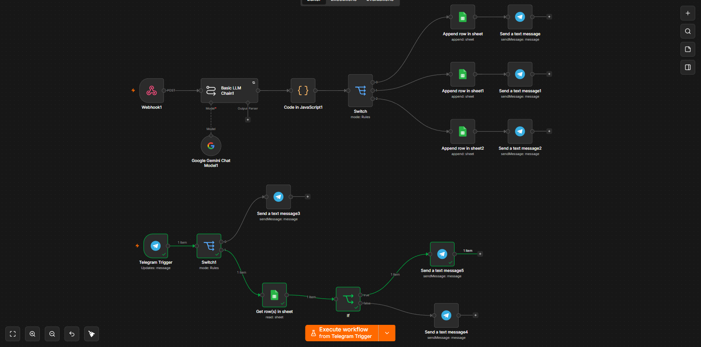

# Sistema Automatizado de Justificación de Inasistencias


Automatización que **recibe solicitudes de justificación de inasistencia** de estudiantes, las evalúa con inteligencia artificial, las registra en Google Sheets y **notifica el resultado en tiempo real por Telegram**, sin intervención humana en los casos claros.



---

## Arquitectura

```
┌──────────────┐   POST multipart   ┌────────────────────────── n8n ──────────────────────────┐
│  Formulario  │ ─────────────────► │ Webhook → Gemini (LLM) → Sanitización → Switch (≥80%)   │
│  web (HTML)  │                    │            │                              │              │
└──────────────┘                    │            ▼                              ▼              │
                                    │   Google Sheets (Aprobados / Rechazados / Pendientes)    │
                                    │            │                                             │
                                    │            ▼                                             │
                                    │   Telegram → notificación al estudiante                  │
                                    └──────────────────────────────────────────────────────────┘
```

| Capa | Rama | Contenido |
|------|------|-----------|
| Frontend | `frontend` | Formulario web (`index.html`, `style.css`, `app.js`) |
| Backend | `backend` | Workflow de n8n (`Proyecto_n8n.json`) y evidencia del flujo |

## Flujo principal

1. **Webhook** — recibe el formulario (`POST`) con nombre, motivo, descripción, ID de estudiante, ID de Telegram, correo, fecha y archivo adjunto.
2. **Basic LLM Chain + Google Gemini** — evalúa el caso con un prompt estructurado y devuelve siempre un JSON con:
   - `veredicto`: `Aprobado`, `Rechazado` o `Dudoso`
   - `nivel_confianza`: número de 0 a 100
   - `razon`: explicación breve
3. **Code (JavaScript)** — limpia la respuesta del LLM (bloques Markdown, texto extra). Si el parseo falla, devuelve un objeto seguro por defecto (`Dudoso`, confianza 0) para que el flujo nunca se detenga.
4. **Switch** — enruta según la confianza:
   - **≥ 80** → caso claro → resolución automática
   - **< 80** → caso dudoso → revisión manual
5. **Google Sheets (×3)** — registra el caso en la hoja correspondiente: *Aprobados*, *Rechazados* o *Pendientes de revisión*.
6. **Telegram (×3)** — notifica al estudiante el veredicto al instante.

## Bot de consulta (flujo secundario)

Los estudiantes pueden consultar el estado de su solicitud enviando su ID al bot de Telegram:

| Nodo | Función |
|------|---------|
| `Telegram Trigger` | Escucha los mensajes del bot |
| `Switch` | Distingue si el mensaje es un saludo o un ID |
| `Get row(s) in sheet` | Busca el registro por ID de estudiante |
| `If` | Si existe, envía el veredicto; si no, avisa que no hay registro |

## Formulario web

- Envío con `fetch` y `FormData` (incluye archivo binario).
- **Validación de tamaño** del adjunto (máximo 5 MB) antes de enviar.
- Bloqueo del botón durante el envío para evitar solicitudes duplicadas.
- Manejo de errores HTTP y de red con mensajes de depuración en consola.

## Estructura del proyecto

```
proyecto-n8n/
├── index.html          # Formulario de justificación
├── style.css           # Estilos del formulario
├── app.js              # Envío al webhook de n8n y validaciones
├── Proyecto_n8n.json   # Workflow exportado de n8n
└── screenshot.png      # Evidencia del flujo
```

## Instalación y uso

### 1. Importar el workflow (backend)

1. Tener n8n instalado (n8n Cloud o Docker):
   ```bash
   docker run -it --rm -p 5678:5678 -v n8n_data:/home/node/.n8n docker.n8n.io/n8nio/n8n
   ```
2. En n8n: **New Workflow → Import from File** y selecciona `Proyecto_n8n.json`.
3. Configura las credenciales:
   - **Google Sheets API** — apuntando a la hoja de control.
   - **Telegram Bot Token** — generado con `@BotFather`.
   - **Google Gemini API Key** — desde Google AI Studio.
4. Activa el flujo.

### 2. Ejecutar el formulario (frontend)

```bash
git clone https://github.com/IkerDahinten2/proyecto-n8n.git
cd proyecto-n8n
npx serve .
```

El formulario envía los datos a `http://localhost:5678/webhook-test/justificacion-inasistencia` (definido en `app.js`). Para producción, cambia la URL por la del webhook activo.

## Flujo de ramas

| Rama | Propósito |
|------|-----------|
| `main` | Versión estable |
| `dev` | Integración de frontend y backend |
| `frontend` | Formulario web |
| `backend` | Workflow de n8n |

## Autor

**Iker Dahinten** — [@IkerDahinten2](https://github.com/IkerDahinten2)
